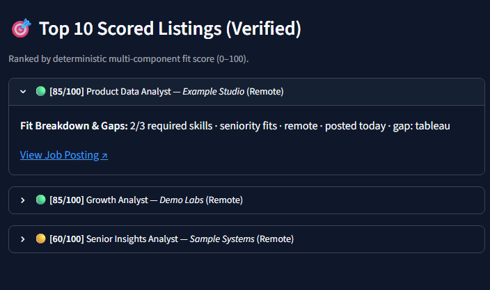

# ⚡ EdgeDash — Autonomous Career Intelligence Agent

EdgeDash helps job seekers answer two questions before applying: which openings are worth a closer look, and which missing skill would be worth learning next? It collects job listings, ranks them against a configurable profile, and shows the reasons behind each score in a Streamlit dashboard.

**My role:** I designed and built the job collection pipeline, scoring and skill-gap logic, data-quality checks, and dashboard. The [project design notes](steering/edgedash.md) capture the decisions behind the build.

## Product decisions

| Decision | Why it matters |
|---|---|
| Use AI to extract job requirements and rules to score fit | Job descriptions vary in format. A model extracts stated requirements, while configurable weights make skill, seniority, location, and recency scores reproducible for the same inputs. |
| Weight missing skills by the fit of the jobs that require them | A skill that appears in several close matches can be a better learning priority than a common skill in jobs far outside the target profile. |
| Show data quality and freshness | Checks look for issues such as implausible score distributions, sparse skill extraction, and stale data. The dashboard surfaces cycle status and the time of the last passing run. |

## Dashboard walkthrough



*Local dashboard with synthetic listings and a sample candidate profile.*

1. Open a ranked listing and read which requirements match your profile, which skills are missing, and how seniority and location affect the score.
2. Check the skill-gap panel to see which skills recur across close matches. For example, an analyst who already knows SQL and Python might review how often Tableau appears in otherwise suitable roles.
3. Ask a question such as “What are my best matches?” to query the stored listings through predefined tools.

## Validation and limitations

The [scoring tests](tests/test_scoring.py), [verification tests](tests/test_verification.py), and [query tests](tests/test_query_tools.py) cover specific behaviors in the pipeline. The fit score is a prioritization heuristic. Its usefulness depends on the listings collected, the quality of the extracted requirements, and the weights in the profile. A next step would be to compare the rankings with job seekers’ shortlists and record which extraction errors changed their decisions.

---

## 📁 Repository Structure

```text
├── .streamlit/
│   └── config.toml          # Dark theme UI configuration
├── edgedash/
│   ├── agents/              # Autonomous agent implementations
│   │   ├── base.py
│   │   ├── fetcher.py
│   │   ├── scorer.py
│   │   ├── gap_analyzer.py
│   │   ├── verifier.py
│   │   └── extractor.py
│   ├── orchestrator.py        # Coordinates each scheduled cycle
│   ├── query/               # Natural language query pipeline & abuse guards
│   │   ├── ask.py
│   │   ├── guards.py
│   │   └── tools.py
│   ├── sources/             # Job board fetcher adapters
│   ├── config.py            # Configuration loader
│   ├── llm.py               # Multi-provider LLM client
│   ├── storage.py           # Unified Postgres/SQLite storage layer
│   └── skills.py            # Skill extraction & canonicalization
├── tests/                   # Automated tests
├── app.py                   # Streamlit dashboard
├── run_cycle.py             # Scheduled autonomous execution entrypoint
├── config.yaml              # User preferences & threshold configurations
├── requirements.txt         # Python dependencies
└── .env.example             # Template environment variables
```

---

## 🚀 Quick Start (Local Development)

### 1. Clone and install dependencies

Use Python 3.11.

```bash
git clone https://github.com/Rehansheikh787/EdgeDash-autonomous-career-agent.git
cd EdgeDash-autonomous-career-agent

python -m venv .venv
# On Windows PowerShell:
.\.venv\Scripts\Activate.ps1
# On Linux/macOS:
source .venv/bin/activate

pip install -r requirements.txt
```

### 2. Configure Environment
Copy [`.env.example`](.env.example) to `.env`. Set `GROQ_API_KEY` for the [default Groq configuration](config.yaml), or supply the key for the provider you configure. Edit `config.yaml` to match your target role, skills, and locations. Local storage uses SQLite when `DATABASE_URL` is unset.
```bash
cp .env.example .env
```

### 3. Initialize & Check Database
```bash
python -m edgedash.storage --migrate
python -m edgedash.storage --check
```

### 4. Run an Autonomous Data Cycle
```bash
python run_cycle.py
```

### 5. Launch the Dashboard
```bash
streamlit run app.py
```

---

## 🧪 Testing

Run all unit tests:
```bash
python -m unittest discover -s tests
```

---

## 📄 License

MIT License

---
